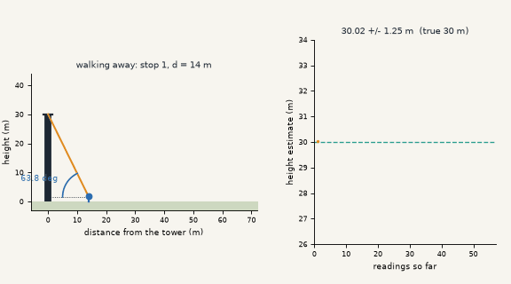
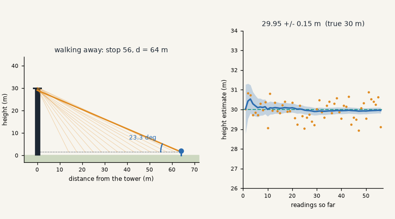
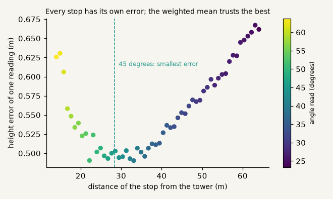
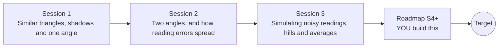

# openheights

[](https://github.com/KrunalPanchal1995/openheights/actions/workflows/ci.yml)   [](https://colab.research.google.com/github/KrunalPanchal1995/openheights/blob/main/sessions/session-01/lesson.ipynb) [](https://krunalpanchal1995.github.io/openheights/)

**Measure a tower or a tree with trigonometry and a phone, in three sessions.**

openheights teaches how to measure the height of something you cannot climb, from similar triangles to noisy phone readings and honest error bars, using only Python and a browser.

- **Start from zero.** Session 1 needs only school trigonometry (tangent of an angle); everything else is explained.
- **See it move.** Every session ships a slider app that runs in the browser, with labelled graphs.
- **Know you got it right.** Each session ends with a checkpoint that prints PASS or FAIL against hand calculations.
- **Build the missing half.** The repo stops at Session 3 on purpose; the roadmap shows the path to the Target.

[Target](#the-target) · [Who is this for](#who-is-this-for) · [Quick start](#quick-start) · [Sessions](#sessions) · [Roadmap](#roadmap) · [Contribute](#contribute) · [Explainer PDF](docs/explainer.pdf)

> **This repo is incomplete on purpose.** Sessions 1 to 3 are here and fully working. The finished Target below is a preview of what the community can build next. We show you the path, not the code. Sessions 4 and up are yours.

## The Target

An observer walks away from a 30 m tower and reads a phone angle at every stop. On the left, the sight lines fan out from each stop to the top. On the right, the height estimate from all readings so far wobbles at first and then settles on the true height, inside a shrinking error band: it ends at 29.95 m with a 2-sigma band of 0.15 m. Stops far from the tower count less, because their error is larger. Your goal over the coming sessions: build that estimator yourself and report a height with an honest uncertainty.



*Target: walking away from a tower, the weighted height estimate converges inside an error band*



*Target, last frame: 29.95 m with a 2-sigma band of 0.15 m*



*Every stop has its own error; the error is smallest near 45 degrees*

Try it live:

- [Math Visual Studio: analytic geometry and curves (Atlas S05)](https://krunalpanchal1995.github.io/studio/#atlas?ch=S05&ex=1)
- [Math Visual Studio: open the studio (trigonometry chapter S04 has no live examples yet)](https://krunalpanchal1995.github.io/studio/)

How the Target was made is shown only as a path in [promo/roadmap.md](promo/roadmap.md).

## Who is this for
**secondary school to diploma / undergraduate (levels 3-5).** Topic area: Mathematics and Visual Problem-Solving.

Prerequisites:

- Sine, cosine and tangent of an angle in a right triangle (school trigonometry).
- Python 3.10 or newer; if `python --version` works, you are ready. PRIMER.md explains the rest.
- No prior GitHub, statistics or surveying experience is needed.

New to Python? Read [PRIMER.md](PRIMER.md) first (10 minutes).

## Quick start

No installation knowledge needed. You need [Git](https://git-scm.com/downloads) and [Python 3.10+](https://www.python.org/downloads/) (Windows: tick "Add Python to PATH"). On Mac and Linux type `python3` wherever this page says `python`.

```bash
git clone https://github.com/KrunalPanchal1995/openheights.git
cd openheights
python start.py 1
```

`start.py` creates a private environment, installs what is needed and runs Session 1 with its checkpoint. Next: `python start.py 2`, `python start.py 3`, or `python start.py test` to check everything. Only a checkpoint: `python start.py check 1`.

Four lines turn the idea of Session 1 into a result (they work as they are): Save it as `try.py` and run it with `python start.py run try.py` (this uses the private environment, where NumPy is installed):

```python
import numpy as np
d, angle, eye = 40.0, 35.0, 1.6                  # metres, degrees, metres
h = d * np.tan(np.radians(angle)) + eye           # height = d tan(angle) + eye height
print(round(h, 2), 'm')                           # -> 29.61 m
```

Every session also opens in your browser with sliders (no install): [live apps](https://krunalpanchal1995.github.io/openheights/). Or use the Colab badge above for the notebook.

## Sessions

| # | Session | Model level | Time | Live app |
|---|---|---|---|---|
| 1 | [Similar triangles, shadows and one angle](sessions/session-01/README.md) | Level 1: conceptual interactive model | 60 min | [open](https://krunalpanchal1995.github.io/openheights/session-01/) |
| 2 | [Two angles, and how reading errors spread](sessions/session-02/README.md) | Level 2: mathematical engineering model | 75 min | [open](https://krunalpanchal1995.github.io/openheights/session-02/) |
| 3 | [Simulating noisy readings, hills and averages](sessions/session-03/README.md) | Level 3: simulation and validation | 90 min | [open](https://krunalpanchal1995.github.io/openheights/session-03/) |

Each session follows the same six steps: A real-world problem, B concept and theory, C visual explanation, D interactive simulation, E worked example and experiment, F assessment and design challenge. Each ends with `checkpoint.py`, which prints `PASS` or `FAIL` against reference numbers. Session 3 also contains the real-world mini-project: **Measure your school's flagpole**.

## Architecture



| Folder or file | What is inside |
|---|---|
| `sessions/` | three sessions: README (A-F), `lesson.py`, notebook, live app, exercises, activity sheet, checkpoint |
| `promo/` | the Target: media, live links, and the roadmap (path only) |
| `docs/` | `explainer.tex` and the built `explainer.pdf` |
| `tests/` | runs every lesson and checkpoint headless |
| `start.py` | one command to set up and run anything |
| `QUALITY.md`, `RUBRIC.md` | the quality checklist and the scoring rubric |
| `.github/` | CI, PDF build, Pages deploy, issue and PR templates |

## Roadmap

| Milestone | What you will build | Difficulty |
|---|---|---|
| Session 4: Calibrate the phone | A small model of a clinometer with an offset and noise, and a calibration routine that uses readings from both sides. | intermediate |
| Session 5: Outlier-proof averaging | An estimator that rejects outliers and still reports an uncertainty. | intermediate |
| Session 6: Measure a leaning tree | A solver that finds the vertical height and the lean angle from readings taken from several places. | advanced |
| Session 7: Unknown ground: three stations | A least-squares fit of height and base position from readings at three non-collinear stations. | advanced |
| Session 8: Animate the walk-away estimate | A looping animation of an observer walking away from a tower with sight lines and a converging estimate. | advanced |

Full detail with a checkpoint per milestone: [promo/roadmap.md](promo/roadmap.md).

## Contribute
New to GitHub? Read [CONTRIBUTING.md](CONTRIBUTING.md); it starts from zero. Pick an issue labelled `good first issue`. Translations into Hindi, Telugu, Tamil and Malayalam are welcome.

<details>
<summary>Development</summary>

```bash
python start.py test        # runs every lesson and checkpoint
```
Lessons use `# %%` cell markers so they open as notebooks in VS Code. See [QUALITY.md](QUALITY.md) for the standard every session meets.
</details>

## License
MIT. See [LICENSE](LICENSE). Media in `promo/media` is (c) Krunal Panchal, CC BY 4.0.

## Acknowledgments
Part of the [PAN IIT OSS](https://hellofoss.tech-iitb.org/projects) open-source teaching collection, modelled on the structure of [openspline](https://github.com/openspline/openspline). Built on ideas from the Math Visual Studio at https://krunalpanchal1995.github.io/studio/.
