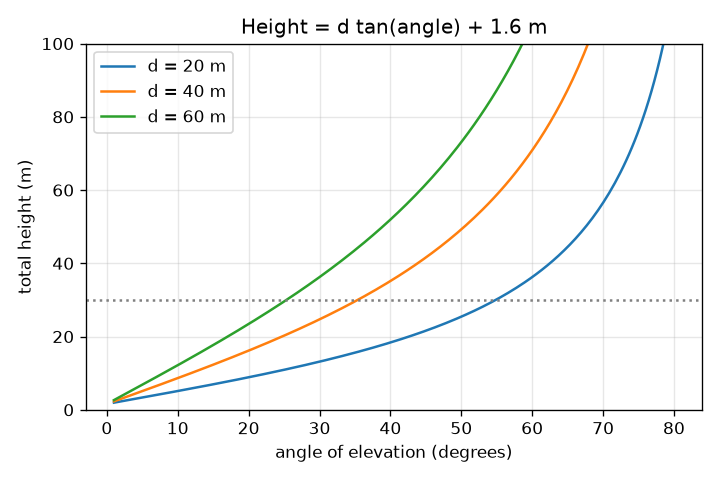
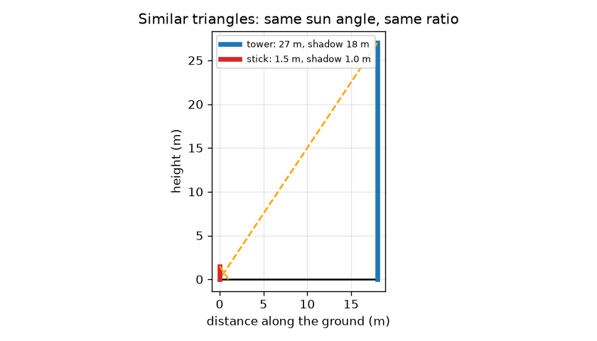

# Session 1: Similar triangles, shadows and one angle

*Level 1 (conceptual interactive model) · about 60 minutes · openheights*

> This is a simplified educational model. It is not a validated design tool and must not be used for real structures, electrical installations, vehicles, industrial processes or medical decisions.

**Prerequisites**

- Tangent of an angle in a right triangle (school trigonometry).
- You have read PRIMER.md and run `python start.py 1` once.

**Learning objectives.** After this session you can:

- Use similar triangles to find a height from shadows.
- Explain what the angle of elevation is and measure it with a phone.
- Use height = distance x tan(angle) and add the eye height.
- Read a graph of height against angle for a fixed distance.

## A. Real-world problem
You cannot climb a tower or a tree with a tape measure, but you can stand on the ground. Two everyday tricks give the height: the shadow it casts, and the angle you tilt your head (or phone) to see its top. Why do these work, and what do you need to know about the ground?

## B. Concept and theory
Two triangles with the same angles are similar: their sides are in the same ratio. At one moment the sun makes the same angle with the ground everywhere, so a stick and a tower with their shadows form similar triangles, and height / shadow is the same for both. The angle of elevation a is measured from the horizontal at your eye up to the top. In the right triangle with horizontal side d and vertical side H above your eye, tan(a) = H / d, so H = d tan(a). The tower is higher than your eye by that amount, so you add your eye height to get the total height. This is a simplified model: flat ground, a vertical tower, a perfectly level phone and an exact distance.

| Symbol | Meaning | Unit |
|---|---|---|
| h_t, s_t | tower height and its shadow length | m |
| h_s, s_s | stick height and its shadow length | m |
| d | horizontal distance from you to the base | m |
| a | angle of elevation to the top | degrees |
| e | eye height above the ground | m |
| h | total height of the tower | m |

**Assumptions**

- The ground is flat and level between you and the tower.
- The tower is vertical and you can walk to its base to measure d.
- Shadows are measured at the same moment, on the same flat ground.
- The angle is read exactly (errors are the topic of Sessions 2 and 3).

$$ \frac{h_t}{s_t}=\frac{h_s}{s_s}\quad\Rightarrow\quad h_t=h_s\,\frac{s_t}{s_s} $$

$$ \tan a=\frac{h-e}{d} $$

$$ h=d\tan a+e $$

## C. Visual explanation
The first figure draws the stick and the tower with their shadows: the two orange lines (sunrays) have the same slope, and the two triangles are the same shape at different sizes. The second figure plots the total height against the angle for three distances. Every curve starts at the eye height and rises slowly, then steeply: the tangent grows fast near 90 degrees. Doubling the distance doubles the height above the eye at the same angle.

*Total height against angle for three distances: the tangent curve gets steeper at large angles.*

*Similar triangles: a 1.5 m stick and a 27 m tower share the same sun angle.*

## D. Interactive simulation
Run the lesson (`python start.py 1`), then open the live app: [Session 1: height from one angle](https://krunalpanchal1995.github.io/openheights/session-01/) (or `app.html` in this folder). Slide the distance and the angle, and watch the sight line rise towards the top of the grey 30 m tower; then open the graph view and see the point move along the curve.

**Challenge.** Make the estimate equal to the 30 m tower, within 0.5 m.

## E. Worked example and experiment
**Problem.** (a) A 1.5 m stick casts a 1.0 m shadow when a tower casts an 18 m shadow. How tall is the tower? (b) You stand 40 m from another tower, read 35 degrees, and your eye is 1.6 m high. How tall is it?

1. (a) Ratio stick: 1.5 / 1.0 = 1.5 m of height per metre of shadow.
2. (a) Tower: 1.5 x 18 = 27 m.
3. (b) tan 35 degrees = 0.7002.
4. (b) Height above the eye = 40 x 0.7002 = 28.01 m.
5. (b) Total = 28.01 + 1.6 = 29.61 m.

**Answer.** (a) The tower is 27 m tall. (b) The tower is 29.61 m tall.

**Experiment.** Measure a lamp post or a tree twice: once by the shadow method on a sunny day (measure a vertical metre stick and the shadow at the same minute), once by the angle method with a phone clinometer app and a tape. Compare. Expect agreement within a few percent; differences come from fuzzy shadow edges, a sloping ground, a tilted phone and not knowing exactly where the base is. The model has exact lines and a perfectly vertical tower, the field does not.

## F. Assessment and design challenge
**Question type A: Conceptual.** Why do a stick and a tower form similar triangles with their shadows, and what would go wrong if you measured the stick's shadow at 9 am and the tower's at 11 am?

Hint

Similar means same angles. What sets the angle between the sun ray and the ground?

Step-by-step solution

At one moment the sun rays are parallel, so the angle between the sun and the flat ground is the same for stick and tower; the right angle at the ground is also shared, so all angles match and the triangles are similar. At 9 am and 11 am the sun is at different heights, so the shadow-to-height ratio differs and the answer is wrong. Measure both shadows at the same time.

**Question type B: Numerical.** A tree casts a 15 m shadow when a 2.0 m stick casts a 1.2 m shadow. How tall is the tree? Then a different tree is seen at 40 degrees from 12 m away with the eye at 1.6 m; how tall is it?

Hint

Use h_t = h_s s_t / s_s, then h = d tan a + e. tan 40 degrees = 0.8391.

Step-by-step solution

First tree: 2.0 x 15 / 1.2 = 25.0 m. Second tree: 12 x 0.8391 = 10.07 m above the eye, plus 1.6 m gives 11.67 m. Sanity check: at 40 degrees (a bit less than 45) the height above the eye is a bit less than the distance 12 m, so about 10 m is right.

**Question type C: Graph and simulation interpretation.** On the graph of total height against angle for d = 40 m, read the heights at 20, 45 and 60 degrees. What happens to the height per degree as the angle grows?

Hint

Use the curve for d = 40 m, or compute 40 tan(a) + 1.6.

Step-by-step solution

At 20 degrees about 16.2 m, at 45 degrees 41.6 m, at 60 degrees 70.9 m. From 20 to 45 degrees the height gains 25.4 m (about 1.0 m per degree); from 45 to 60 it gains 29.3 m in 15 degrees (about 2.0 m per degree). The curve gets steeper because the tangent grows faster at large angles; a 1 degree slip matters more there.

**Question type D: Design and optimisation challenge.** Design: you think a tree is about 12 m tall and you have a 50 m tape. Choose where to stand and justify it. What would be wrong with standing 2 m away, or 45 m away?

Hint

Compute d for an angle of 45 degrees, where tan a = 1. Think about holding the phone steady at steep angles and about the angle getting small at long distances.

Step-by-step solution

For 45 degrees, tan a = 1, so d = h - e = 12 - 1.6 = 10.4 m. Standing 2 m away gives an angle near 79 degrees: you look almost straight up, the phone is hard to hold, and small angle slips make large height changes (Session 2). Standing 45 m away gives only about 13 degrees, and the top is a small angle above the horizon, so a small slip is a large fraction of the reading and branches or trees may block the view. Trade-off: about 45 degrees is a good compromise, with room for obstacles.

Score yourself with [RUBRIC.md](../../RUBRIC.md). Print the [activity sheet](activity_sheet.md) to work on paper.

## Common misconceptions
| Common misconception | What is actually true |
|---|---|
| The height is just d tan(a). | That is only the height above your eye; add your eye height to get the total height. |
| The distance d is the distance to the top of the tower. | d is the horizontal distance to the base, along the ground; the sight line is longer. |
| The shadow method works at any two times of day. | The stick and the tower shadows must be measured at the same moment, because the sun angle changes. |
| Doubling the angle doubles the height. | Height follows tan(a), which is not proportional to a: 20 degrees gives 16.2 m and 40 degrees gives 35.2 m at d = 40 m (with eye height 1.6 m). |

## Glossary
- **angle of elevation**: the angle from the horizontal up to the object you look at
- **similar triangles**: triangles with the same angles, so their sides are in the same ratio
- **tangent**: in a right triangle, the opposite side divided by the adjacent side
- **clinometer**: a tool or phone app that reads the tilt angle
- **baseline**: the measured distance on the ground that the method relies on

## Finish
1. Do the three coding tasks in [exercises.md](exercises.md).
2. Run `python start.py 1` again after your changes. It ends with the checkpoint; when it prints `PASS`, you are done. (Checkpoint only: `python start.py check 1`.)

Next: [Session 2](../session-02/README.md)
