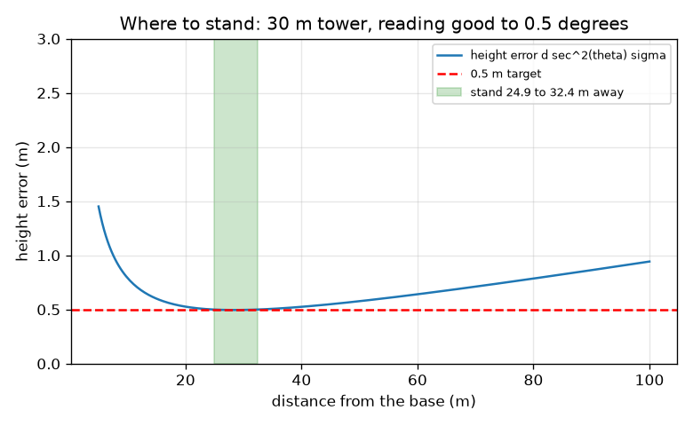
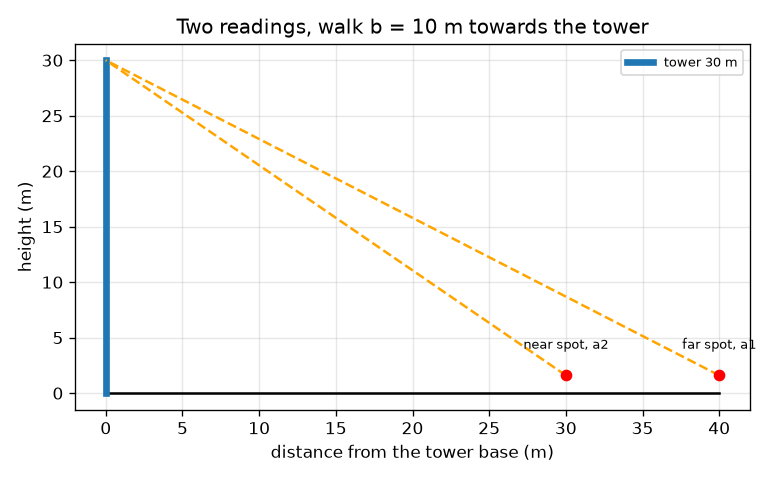

# Session 2: Two angles, and how reading errors spread

*Level 2 (mathematical engineering model) · about 75 minutes · openheights*

> This is a simplified educational model. It is not a validated design tool and must not be used for real structures, electrical installations, vehicles, industrial processes or medical decisions.

**Prerequisites**

- Session 1: height = d tan(angle) + eye height.
- Cotangent is introduced in Section B (cot a = 1 / tan a).

**Learning objectives.** After this session you can:

- Find a height from two angles read at two places when the base is out of reach.
- Propagate a reading error into a height error with d sec^2(theta) times the error.
- Explain why the error is smallest near 45 degrees for a tower of a given height.
- Solve a design problem: where to stand to meet an error limit.

## A. Real-world problem
A moat, a fence or a river stops you reaching the base of the tower, so you do not know the distance. And your phone clinometer is only good to about half a degree. Can you still measure a 30 m tower, and where should you stand so that the answer is within 0.5 m?

## B. Concept and theory
Stand at a far spot and read angle a1; walk b metres straight towards the tower and read angle a2 (larger). With H the height above your eye and x the unknown horizontal distance from the near spot to the base, x = H cot(a2) and x + b = H cot(a1), where cot is 1 / tan. Subtracting eliminates x: H = b / (cot a1 - cot a2). Add the eye height for the total. For errors: if H = d tan(theta), a small reading error dtheta (in radians) changes H by about dH = d sec^2(theta) dtheta, where sec = 1 / cos. Since d = H / tan(theta), this is dH = 2 H dtheta / sin(2 theta), which is smallest (2 H dtheta) when theta = 45 degrees. So for a given tower you should stand where the angle is near 45 degrees, not as far away as possible. The formulas are first-order approximations and assume a vertical tower, flat ground, and a measured baseline. They are a teaching model, not a surveying standard.

| Symbol | Meaning | Unit |
|---|---|---|
| a1, a2 | far and near angle readings (a1 < a2) | degrees |
| b | distance walked towards the tower | m |
| H | height of the top above your eye | m |
| e | eye height | m |
| d | horizontal distance to the base | m |
| theta | angle of elevation | degrees or radians |
| sigma | size of the reading error | degrees (converted to radians in formulas) |
| dH | resulting height error | m |

**Assumptions**

- Both readings are taken at the same eye height on level ground in line with the base.
- The walk b is measured exactly.
- The reading error is small, so the first-order formula holds.
- Errors are of the size sigma; the formula gives the typical size, not a guaranteed limit.

$$ H=\frac{b}{\cot a_1-\cot a_2},\qquad h=H+e $$

$$ x=H\cot a_2\quad\text{(distance from the near spot to the base)} $$

$$ \frac{dH}{d\theta}=d\,\sec^2\theta,\qquad dH=d\sec^2\theta\;\sigma $$

$$ dH=\frac{2H\sigma}{\sin 2\theta}\ \ge\ 2H\sigma\quad(\text{equality at }\theta=45^\circ) $$

## C. Visual explanation
The first figure shows two spots, 40 m and 30 m from a 30 m tower, with their sight lines meeting at the top. The second plots the height error against the distance of a single reading for a 30 m tower and a 0.5 degree reading error. It is a bowl: the minimum 0.496 m is at 28.4 m (45 degrees); at 10 m it is 0.79 m and at 60 m it is 0.64 m. The green band marks the distances 24.9 m to 32.4 m where the error stays within 0.5 m.

*Height error versus distance for a 30 m tower: a bowl with its minimum near 45 degrees; the green band meets the 0.5 m limit.*

*Two readings from 40 m and 30 m: the sight lines meet at the top of the tower.*

## D. Interactive simulation
Run the lesson (`python start.py 2`), then open the live app: [Session 2: where to stand](https://krunalpanchal1995.github.io/openheights/session-02/) (or `app.html` in this folder). Move the distance slider and watch the red segment (the range of heights consistent with the reading error) grow and shrink, then open the graph view and find the bottom of the bowl; change the reading error and see the bowl move up.

**Challenge.** With a reading error of at least 0.5 degrees, stand where the height error is 0.5 m or less.

## E. Worked example and experiment
**Problem.** (a) Two readings, 35.4 degrees at the far spot and 43.5 degrees after walking b = 10 m towards a tower, with eye height 1.6 m. Find the height. (b) For a 30 m tower (28.4 m above the eye) and a reading error of 0.5 degrees, between which distances is the error at most 0.5 m?

1. (a) cot 35.4 degrees = 1.4071 and cot 43.5 degrees = 1.0538 (using cot = 1 / tan).
2. (a) H = 10 / (1.4071 - 1.0538) = 28.30 m above the eye; total = 28.30 + 1.6 = 29.90 m.
3. (b) Convert 0.5 degrees to radians: 0.008727. Need 2 H sigma / sin(2 theta) <= 0.5, so sin(2 theta) >= 2 x 28.4 x 0.008727 / 0.5 = 0.9913.
4. (b) 2 theta is between 82.4 and 97.6 degrees, so theta is between 41.2 and 48.8 degrees.
5. (b) d = H / tan(theta): 28.4 / tan 48.8 = 24.9 m and 28.4 / tan 41.2 = 32.4 m.

**Answer.** (a) The tower is 29.90 m tall. (b) Stand between 24.9 m and 32.4 m from the base: the angle is then between 41 and 49 degrees and the error stays at or below 0.5 m (it equals 0.496 m at best).

**Experiment.** Pick a tower or a lamp post of known height. Read the angle five times from each of three distances (about 45 degrees, much closer, much farther) and compare the spread of your heights with the error formula. You should see the smallest spread near 45 degrees. Differences come from hand tremor, a tilted phone and uneven ground, which the formula does not include.

## F. Assessment and design challenge
**Question type A: Conceptual.** A friend says: stand as far away as possible, then the angle is small and the error is small. Is that right for a tower of a given height? What is true and what is not?

Hint

Write the error as 2 H sigma / sin(2 theta) and ask what happens at small theta.

Step-by-step solution

For a FIXED distance d the error d sec^2(theta) sigma is smaller at smaller angles. But for a given tower you change the angle only by changing d: d = H / tan(theta), and then the error is 2 H sigma / sin(2 theta), which gets large when theta is small (sin 2 theta is small). Far away is worse: for the 30 m tower the error at 100 m is 0.94 m against 0.50 m at 28.4 m.

**Question type B: Numerical.** A 20 m tower (18.4 m above your eye) is read from 18.4 m and from 50 m, with a reading error of 0.5 degrees. Find the height error at each distance.

Hint

At 18.4 m the angle is 45 degrees. For 50 m find the angle from tan(theta) = 18.4 / 50, then use d sec^2(theta) sigma.

Step-by-step solution

At 18.4 m, theta = 45 degrees: error = 2 x 18.4 x 0.008727 = 0.32 m. At 50 m, theta = atan(18.4 / 50) = 20.2 degrees and sec^2 = 1 + (18.4 / 50)^2 = 1.135, so error = 50 x 1.135 x 0.008727 = 0.50 m. The farther position is about 1.5 times worse. Units: metres.

**Question type C: Graph and simulation interpretation.** On the error graph for the 30 m tower (0.5 degrees), where is the minimum and what is its value? Is a 0.5 m limit reachable at 60 m?

Hint

Read the bottom of the bowl and compare the curve at 60 m with the red line.

Step-by-step solution

The minimum is at 28.4 m, where the angle is 45 degrees, and equals about 0.50 m. At 60 m the error is 0.64 m, above the red 0.5 m line, so a single reading from 60 m cannot meet the limit. Only the window 24.9 m to 32.4 m meets it.

**Question type D: Design and optimisation challenge.** Design: the 30 m tower must be measured to within 0.5 m with a clinometer good to 0.5 degrees, but a wall means you can only stand 40 m or farther away. What can you do? Then suppose the clinometer is only good to 1 degree: what is the best possible single-reading error and what could you change?

Hint

Compute the best single-reading error 2 H sigma for sigma = 0.5 and 1 degree. Think about what independent repeats do to a random error (Session 3).

Step-by-step solution

At 40 m the single-reading error is 0.525 m, just above the limit, so one reading is not enough; the practical option is to repeat the reading several times and average (random error falls as 1 / sqrt(n), Session 3). With sigma = 1 degree even the best spot gives 2 x 28.4 x 0.01745 = 0.99 m, so one reading can never meet 0.5 m; averaging n >= (0.99 / 0.5)^2 = 3.9, so at least 4 independent readings, would. Trade-off: more readings cost time, and averaging does not remove a tilted-phone bias.

Score yourself with [RUBRIC.md](../../RUBRIC.md). Print the [activity sheet](activity_sheet.md) to work on paper.

## Common misconceptions
| Common misconception | What is actually true |
|---|---|
| The farther I stand, the smaller the error. | For a given tower the error is smallest near 45 degrees and grows both when you are too close and when you are too far. |
| The two readings must be taken at the same distance. | They must be taken at different distances in a line with the tower, a known baseline b apart. |
| The reading error in degrees can be put directly into the formula. | Convert degrees to radians (multiply by pi / 180) before using d sec^2(theta) times the error. |
| The error formula is a guarantee. | It is the typical size of a small random error; a larger slip or a systematic bias can be bigger. |

## Glossary
- **cotangent**: cot a = 1 / tan a: the adjacent side divided by the opposite side
- **secant**: sec a = 1 / cos a; sec^2 a = 1 + tan^2 a
- **baseline**: the measured distance b walked between the two readings
- **error propagation**: working out how an error in an input changes the output
- **radian**: angle unit where a half turn is pi; degrees x pi / 180

## Finish
1. Do the three coding tasks in [exercises.md](exercises.md).
2. Run `python start.py 2` again after your changes. It ends with the checkpoint; when it prints `PASS`, you are done. (Checkpoint only: `python start.py check 2`.)

Next: [Session 3](../session-03/README.md)
