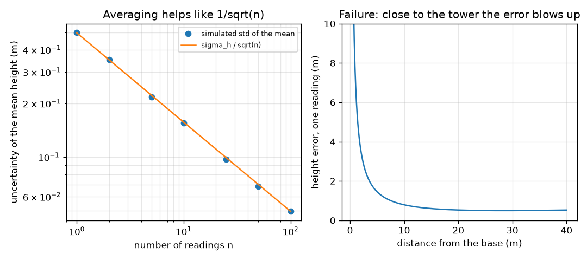
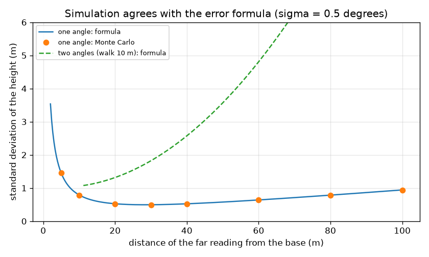

# Session 3: Simulating noisy readings, hills and averages

*Level 3 (simulation and validation) · about 90 minutes · openheights*

> This is a simplified educational model. It is not a validated design tool and must not be used for real structures, electrical installations, vehicles, industrial processes or medical decisions.

**Prerequisites**

- Session 1: height = d tan(angle) + eye height.
- Session 2: two-angle method and the error formula d sec^2(theta) sigma.
- Mean and standard deviation of a list of numbers.

**Learning objectives.** After this session you can:

- Simulate noisy phone readings from exact geometry and recover the height.
- Average n readings and report a standard error s / sqrt(n).
- Validate the error formulas for one and two angles against a Monte Carlo simulation.
- Correct a measurement made on a slope, and identify the failure near 90 degrees.

## A. Real-world problem
A phone clinometer never gives the same angle twice. Is the error formula from Session 2 right? Does averaging many readings help, and by how much? Is the two-angle method better? What if you stand on a hill, or so close to a tall tower that you look almost straight up? And finally: how tall is the school flagpole, with an honest error bar?

## B. Concept and theory
A simulation starts from exact geometry: the true angle is atan(H / d). The phone adds a random error with standard deviation sigma, so the reading is the true angle plus noise, and each reading gives a height estimate. The mean of n independent estimates has standard error s / sqrt(n), where s is the sample standard deviation (with n - 1 in the denominator): averaging shrinks random error but not a systematic one such as a tilted phone. A Monte Carlo test repeats the measurement thousands of times and compares the spread of the results with the formula. The two-angle error is found by propagating both reading errors: each partial derivative of H = b / (cot a1 - cot a2) is multiplied by sigma and the two contributions are added in quadrature. On a slope with angle phi (ground rising towards the tower), a tape along the ground gives the slope distance s, the horizontal distance is D = s cos(phi), and the tower height above its base is D (tan a - tan phi) + e. Ignoring the slope gives e + s tan a, which is wrong. This is a simplified model: independent Gaussian errors, a vertical tower, a level phone and a straight slope. It is not a surveying standard.

| Symbol | Meaning | Unit |
|---|---|---|
| sigma | standard deviation of one angle reading | degrees |
| n | number of readings averaged | no unit |
| s | sample standard deviation of the heights | m |
| SEM | standard error of the mean, s / sqrt(n) | m |
| phi | ground slope angle (positive rising towards the tower) | degrees |
| s_d, D | slope distance along the ground and horizontal distance D = s_d cos(phi) | m |
| b, a1, a2 | walk and the two readings of the two-angle method | m, degrees |

**Assumptions**

- Reading errors are independent, Gaussian and have the same sigma.
- The tower is vertical and the baseline or tape distance is exact (or its error is added separately).
- The slope is a straight plane and you know its angle phi.
- A reading of 90 degrees or more is physically invalid.

$$ \hat h=d\tan(\theta_{\mathrm{true}}+\varepsilon)+e,\qquad \varepsilon\sim N(0,\sigma^2) $$

$$ \mathrm{SEM}=\frac{s}{\sqrt n} $$

$$ \sigma_H^{(1)}=d\sec^2\theta\,\sigma,\qquad \sigma_H^{(2)}=\sigma\,\frac{b\sqrt{\csc^4 a_1+\csc^4 a_2}}{(\cot a_1-\cot a_2)^2} $$

$$ h=D(\tan a-\tan\varphi)+e,\qquad D=s_d\cos\varphi $$

## C. Visual explanation
The first figure plots the standard deviation of the height against distance for a 30 m tower and 0.5 degree noise: the Monte Carlo dots lie on the one-angle formula curve, and the two-angle curve with a 10 m walk lies far above it. The second figure shows two things: the uncertainty of the mean falling as 1 / sqrt(n), with simulated points on the line, and the single-reading error blowing up close to the tower, where the angle approaches 90 degrees.

*Left: averaging n readings follows 1 / sqrt(n). Right: close to the tower the single-reading error blows up.*

*Monte Carlo standard deviation matches the one-angle formula; the two-angle curve with a 10 m walk is much worse.*

## D. Interactive simulation
Run the lesson (`python start.py 3`), then open the live app: [Session 3: hill, readings and uncertainty](https://krunalpanchal1995.github.io/openheights/session-03/) (or `app.html` in this folder). Set a slope and a distance, read the slope-corrected height and the naive one in the readout, then increase the number of readings and watch the uncertainty fall; in the graph view, drag the distance to the bottom of the bowl.

**Challenge.** On a slope of at least 10 degrees, make the uncertainty of the mean height 0.15 m or less.

## E. Worked example and experiment
**Problem.** (a) A 30 m tower stands 30 m (horizontal) up a 10 degree slope from you, eye height 1.6 m. The true top angle is 48.32 degrees. Find the height ignoring the slope and with the slope correction. (b) The flagpole data (12 readings at 18.0 m, eye 1.55 m) give heights with a mean of 9.38 m and a standard error of 0.035 m. How big is the tape error contribution for a 0.1 m tape error, and what is the combined uncertainty?

1. (a) Slope distance s = 30 / cos 10 degrees = 30.46 m. Ignoring the slope: 1.6 + 30.46 x tan 48.32 degrees = 35.81 m.
2. (a) With the correction: 30 x (tan 48.32 - tan 10) + 1.6 = 30 x (1.1230 - 0.1763) + 1.6 = 30.00 m.
3. (b) The tape error enters like a distance error: 0.1 m x tan(mean angle 23.5 degrees) = 0.1 x 0.4350 = 0.0435 m (angle of the mean reading).
4. (b) Combine in quadrature: sqrt(0.035^2 + 0.0435^2) = 0.056 m.
5. (b) Report: 9.38 +/- 0.06 m.

**Answer.** (a) Ignoring the slope gives 35.81 m, wrong by 5.8 m; the correction gives the true 30.00 m. (b) The flagpole is 9.38 +/- 0.06 m (standard error 0.035 m, tape contribution 0.044 m).

**Experiment.** Measure a real tree or flagpole at least 20 times with a phone clinometer app, from a taped distance. Compute the mean and the standard error and compare it with the 1 / sqrt(n) prediction using your sigma. Then deliberately tilt the phone by 1 degree and repeat. Expect the spread to stay the same but the mean to shift: averaging does not remove a systematic error. The simulation has independent Gaussian noise and a perfect phone, the field does not.

## Real-world application and mini-project: Measure your school's flagpole
You stood 18.0 m (horizontal, by tape, good to 0.1 m) from the flagpole with your eye 1.55 m above the ground, and took 12 phone readings of the angle to the top. The synthetic readings are stored in `FLAG_READINGS` in Session 3. Turn the 12 readings into a height with an uncertainty, using `h_one`, `mean_and_sem` and the tape error.

**Deliverable:** A script that prints the 12 heights, the mean, the standard error, the uncertainty from the 0.1 m tape error, the two combined in quadrature (square root of the sum of squares), and a one-line report such as `flagpole height 9.38 +/- 0.06 m`, plus a plot of the 12 heights with the mean and its error band.

**Success looks like:** The report gives a mean of 9.38 m with a combined uncertainty of about 0.06 m (standard error 0.035 m, tape error 0.04 m), and the flagpole's true height of 9.40 m (known for this synthetic example) lies inside the reported range.

## F. Assessment and design challenge
**Question type A: Conceptual.** Your phone is tilted so that every reading is 1 degree too large. Does averaging 100 readings fix it? What would?

Hint

Compare random and systematic errors, and what the standard error measures.

Step-by-step solution

No. The standard error measures the random scatter, which falls as 1 / sqrt(n), but a constant offset shifts the mean by the same amount however many readings you take. The bias at 45 degrees and 28.4 m is 28.4 x 2 x 0.01745 = 0.99 m. Calibrate the phone first (for example against a known horizontal), or measure the same known height and correct the offset.

**Question type B: Numerical.** At 45 degrees and 28.4 m, one reading gives a height error of 0.496 m. How many readings must you average to bring the standard error to 0.1 m or below? What do you get with 25?

Hint

SEM = sigma_H / sqrt(n); solve for n and round up.

Step-by-step solution

n >= (0.496 / 0.1)^2 = 24.6, so n = 25. With 25 readings the standard error is 0.496 / 5 = 0.099 m, matching the simulation (0.097 m). Sanity check: sqrt(25) = 5, so 25 readings make the error 5 times smaller than one reading.

**Question type C: Graph and simulation interpretation.** In the Monte Carlo results for far reading at 40 m, the one-angle standard deviation is 0.52 m while the two-angle method gives 2.64 m for a 10 m walk and 0.74 m for a 30 m walk. Explain what the graph shows and when the two-angle method is worth using.

Hint

The two-angle method subtracts two cotangents that are nearly equal when the walk is short.

Step-by-step solution

A short walk makes cot a1 - cot a2 small, so the angle errors are divided by a small number squared and amplified. A longer walk improves it but one-angle with a known distance stays better (0.52 m at 40 m). Use the two-angle method only when you cannot measure the distance to the base, and then walk as far as you can: the 30 m walk gives 0.74 m.

**Question type D: Design and optimisation challenge.** Design: a 30 m tower on a 10 degree slope, a clinometer good to 0.5 degrees, and a limit of 0.15 m on the uncertainty of the mean. Choose the horizontal distance and the number of readings. What could go wrong at 3 m?

Hint

The best distance puts the top angle near 45 degrees; the top is 28.4 + D tan(10 degrees) above your eye.

Step-by-step solution

The top angle is 45 degrees when D = 28.4 + D tan 10, so D = 28.4 / (1 - 0.1763) = 34.5 m; take D = 35 m. One reading gives about 0.60 m, so n >= (0.60 / 0.15)^2 = 16; with n = 25 the uncertainty is 0.12 m. At 3 m the top angle is about 84 degrees and the single-reading error is 2.5 m: you are in the failure region, and a reading near 90 degrees also has a large bias (for example a bias of +0.4 m at 2 m from the tower on flat ground). Trade-off: more readings take time and cannot fix a slope angle you did not measure.

Score yourself with [RUBRIC.md](../../RUBRIC.md). Print the [activity sheet](activity_sheet.md) to work on paper.

## Common misconceptions
| Common misconception | What is actually true |
|---|---|
| More readings can fix any error. | Averaging reduces random scatter by 1 / sqrt(n) but leaves a systematic error (tilted phone, wrong tape) unchanged. |
| The slope does not matter if I measure the distance with a tape. | A tape along a slope gives the slope distance, not the horizontal one, and the base is higher or lower than your feet; both must be corrected. |
| The standard error is the error of one reading. | The standard deviation s describes one reading; the standard error s / sqrt(n) describes the mean. |
| Standing very close to a tall tower gives a precise height because the distance is short. | Near 90 degrees d sec^2(theta) explodes; the formula also stops being accurate and the error becomes biased. |

## Glossary
- **Monte Carlo**: repeating a random experiment many times on a computer to see the spread of the results
- **standard deviation**: the typical size of the scatter of single values around the mean
- **standard error**: the standard deviation of the mean: s / sqrt(n)
- **systematic error**: an error that pushes every reading the same way, such as a tilted phone
- **quadrature**: combining independent errors as the square root of the sum of squares

## Finish
1. Do the three coding tasks in [exercises.md](exercises.md).
2. Run `python start.py 3` again after your changes. It ends with the checkpoint; when it prints `PASS`, you are done. (Checkpoint only: `python start.py check 3`.)

Next: the [roadmap](../../promo/roadmap.md). Session 4 is yours to build.
